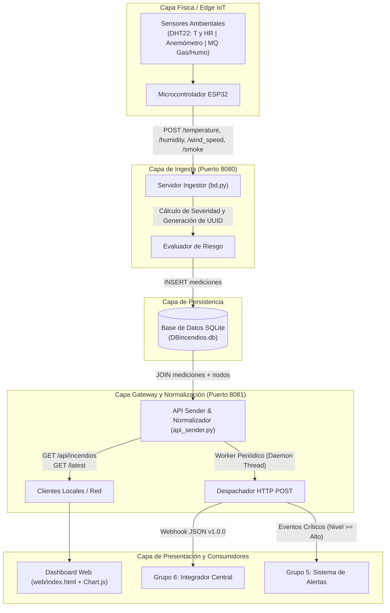

# 🔥 Nodo de Monitoreo Ambiental y Riesgo de Incendios Forestales
### *Caso de Estudio: Caviahue-Copahue — Grupo 1 (Navathon III, 2026)*


---

## 📋 Resumen Ejecutivo y Contexto Operativo

Este repositorio contiene la solución técnica integral desarrollada por el **Grupo 1** durante la **Navathon III (2026)**. El proyecto aborda la problemática de los incendios forestales en el ecosistema andino-patagónico de **Caviahue-Copahue** (Departamento Ñorquín, Provincia del Neuquén, Argentina).

La localidad se emplaza a una altitud operativa de entre 1.600 y 1.650 m s. n. m., en una zona de convergencia biogeográfica donde predominan bosques milenarios de Pehuén (*Araucaria araucana*), masas de Lenga (*Nothofagus pumilio*), sotobosque denso de Ñire (*Nothofagus antarctica*) y pastizales esteparios de Coirón y Neneo. Durante la temporada estival, la marcada radiación solar, el régimen de vientos cordilleranos intensos (ráfagas de 50 a 90 km/h) y el desplome abrupto de la humedad relativa generan condiciones propicias para conatos de ignición rápida y propagación violenta. Asimismo, el área alberga especies de fauna de alta vulnerabilidad y baja movilidad, como la lagartija endémica de Copahue (*Liolaemus copahuensis*).

Para mitigar este riesgo, el sistema implementa una red local orientada a capturar variables micrometeorológicas in situ, evaluar de forma continua el índice de riesgo mediante algoritmos de combustible fino, almacenar series históricas y disponibilizar la telemetría normalizada hacia otros subsistemas de la competencia:

- **Grupo 6 (Dashboard Integrador Central):** Consumo periódico del estado ambiental del nodo normalizado en formato JSON estándar.
- **Grupo 5 (Sistema de Alertas Comunitarias):** Recepción y propagación de eventos críticos cuando los parámetros meteorológicos superan los umbrales de seguridad.

---

## 🏗️ Arquitectura del Sistema

La solución opera mediante un esquema desacoplado compuesto por un nodo sensor de borde (edge), dos capas de servicios basadas en HTTP, un motor de persistencia relacional embebido y una interfaz web para operadores locales:



### 1. Ingesta de Datos (`bd.py`)
Servicio HTTP que expone puertos de escucha para los microcontroladores en campo. Recibe lecturas individuales de temperatura, humedad, viento y humo, analiza la coherencia del dato entrante, computa el estado de alerta según las variables actuales en memoria y persiste el registro en la base de datos local.

### 2. Persistencia Embebida (`DBincendios.db`)
Estructura SQLite optimizada para lecturas rápidas y registros temporales UTC en formato ISO 8601 (`YYYY-MM-DDTHH:MM:SSZ`), vinculada mediante clave foránea a una tabla de metadatos de nodos (`nodos`).

### 3. Gateway de Normalización y Despacho (`api_sender.py`)
Capa de abstracción que lee la última captura registrada en la base de datos, mapea los valores al esquema unificado del subsistema "Monitoreo de incendios forestales" (versión 1.0.0), resuelve cabeceras CORS dinámicamente y ofrece soporte para redes locales privadas (ej. puntos de acceso en `192.168.4.1`). Cuenta además con un worker en segundo plano capaz de enviar webhooks a intervalos configurables.

### 4. Tablero de Control Local (`web/`)
Interfaz gráfica estática construida para visualización de telemetría en tiempo real. Presenta tarjetas de estado dinámicas, alertas cromáticas y gráficos interactivos de tendencias mediante Chart.js.

---

## 🛠️ Stack Tecnológico

El proyecto se diseñó priorizando dependencias mínimas, alta portabilidad y bajo consumo de recursos en entornos de campo:

- **Lenguaje y Entorno de Ejecución:** Python 3.10 o superior.
- **Framework Web Backend:** Flask (microframework para la exposición de endpoints REST livianos en `bd.py` y `api_sender.py`).
- **Base de Datos:** SQLite3 (motor relacional embebido, sin requerimiento de procesos de servidor externos).
- **Módulos de Sistema:** `socket`, `threading`, `urllib`, `sqlite3`, `datetime`, `uuid` (componentes estándar de Python para control de red, hilos daemon y generación de identificadores únicos).
- **Frontend y Visualización:** HTML5 semántico, CSS3 modular (diseño responsivo oscuro) y JavaScript vanilla (ES6+).
- **Librería de Gráficos:** Chart.js 4.x (consumida vía CDN para gráficos lineales reactivos).
- **Hardware y Nodos Sensores:** Plataforma ESP32 con sensores ambientales DHT22 (temperatura y humedad relativa), sensor de gases/humo de la serie MQ y anemómetro para velocidad de viento.

---

## 🌲 Matriz de Clasificación de Riesgo (Calibración Cordillerana 25-25-30)

Los sistemas clásicos internacionales de predicción emplean comúnmente la "Regla 30-30-30" (temperatura superior a 30 °C, humedad relativa inferior a 30% y viento sostenido mayor a 30 km/h). No obstante, en la altitud de Caviahue (1.600 m s. n. m.), la temperatura media veraniega ronda los 13 °C; registrar 25 °C genera un estrés hídrico en la vegetación equivalente al de 35 °C en el llano.

Por este motivo, se adoptó la **Regla Cordillerana 25-25-30** combinada con el modelo de **Humedad del Combustible Fino Muerto (HCFM)** de Nelson-Simard, calculando la pérdida de humedad en la hojarasca y acículas menores a 6 mm de diámetro:

| Nivel de Riesgo | Código | Clasificación | Temperatura ($T$) | Humedad ($HR$) | Viento ($V$) | HCFM Estimada | Comportamiento del Fuego |
| :---: | :---: | :--- | :---: | :---: | :---: | :---: | :--- |
| 1 | `normal` | **Bajo** | < 20.0 °C | > 25.0 % | < 15 km/h | > 20 % | Ignición improbable; alta retención de humedad en pastizales. |
| 2 | `low` | **Moderado** | >= 20.0 °C | <= 25.0 % | 15 - 25 km/h | 15 - 20 % | Ignición factible con llama abierta; avance superficial lento. |
| 3 | `medium` | **Alto** | >= 23.0 °C | <= 25.0 % | 25 - 35 km/h | 10 - 14 % | Combustión activa en sotobosque; desprendimiento de humo visible en ñirantales. |
| 4 | `high` | **Muy Alto / Crítico** | >= 31.0 °C | <= 20.0 % | > 35 km/h | 6 - 9 % | Alerta severa; posibilidad inminente de fuego de copas en araucarias. |
| 5 | `critical` | **Extremo** | >= 35.0 °C | <= 15.0 % | > 45 km/h | < 6 % | Comportamiento explosivo; tormenta de fuego incontrolable en tierra. |

*Nota de implementación:* El sensor de detección de partículas de humo (`smoke_level`) actúa como factor de escalado inmediato: ante concentraciones iguales o mayores a 8.0 ppm el sistema eleva automáticamente el estado a nivel crítico, y a partir de 10.0 ppm fuerza la alerta a nivel extremo independientemente del cuadro térmico.

---

## 🔌 Especificación de APIs y Contratos de Integración

El sistema segrega la ingesta de telemetría de la entrega pública normalizada en dos servicios independientes:

### 📥 Endpoints de Ingesta de Sensores (`bd.py` — Puerto 8080)

Endpoints destinados a la comunicación con microcontroladores o emisores simulados:

- `POST /temperature`: Registra la temperatura ambiental en grados Celsius (°C).
- `POST /humidity`: Registra el porcentaje de humedad relativa (%).
- `POST /wind_speed`: Registra la velocidad media del viento (m/s o km/h).
- `POST /smoke`: Registra la concentración de gases/humo (ppm).

**Formatos aceptados:** Acepta tanto objetos JSON (`{"temperature": 28.5}`, `{"value": 28.5}`) como texto plano crudo (`28.5`). Retorna código `200 OK` con el nivel de alerta reevaluado o `400 Bad Request` ante entradas no convertibles a valor numérico.

---

### 📡 Endpoints del Gateway y Normalizador (`api_sender.py` — Puerto 8081)

Endpoints concebidos para el consumo del dashboard web local y la integración con el Grupo 6 y Grupo 5:

- `GET /api/incendios` (alias: `GET /latest`, `GET /incendios`): Retorna el último registro capturado, enriquecido con la información del nodo y normalizado bajo el esquema oficial v1.0.0.
- `GET /health`: Chequeo de salud del nodo y validación de conectividad con la base SQLite. Devuelve `200` si la base responde correctamente o `500`/`503` en caso de falla o ausencia de datos.
- `GET /status`: Métricas de telemetría, estado del hilo worker, cantidad total de envíos exitosos y registro del último error ocurrido.
- `POST /send-now`: Fuerza un ciclo manual de extracción y envío directo al webhook objetivo configurado.

---

### 📄 Esquema JSON Normalizado (v1.0.0)

Estructura de intercambio enviada a los clientes y consumidores de la red:

```json
{
  "schema_version": "1.0.0",
  "record_id": "68ad318d-c83b-43e0-a032-691f8398a069",
  "record_type": "reading",
  "node_id": "fire_node_01",
  "group": 1,
  "subsystem": "Monitoreo de incendios forestales",
  "timestamp": "2026-10-20T17:25:22Z",
  "status": "active",
  "alert_level": "normal",
  "data": {
    "temperature": 23.7,
    "humidity": 48.1,
    "wind_speed": 0.0,
    "smoke_level": null
  },
  "metadata": {
    "environment": "operational",
    "source_type": "real",
    "alert_evaluated": true,
    "clock_synced": true,
    "units": {
      "temperature": "degC",
      "humidity": "%",
      "wind_speed": "m/s"
    },
    "quality": {
      "temperature": "valid",
      "humidity": "valid",
      "wind_speed": "valid"
    }
  }
}
```

---

## 📁 Estructura del Repositorio

A continuación se detalla la disposición de archivos en el árbol del proyecto:

```text
Nodo-incendios_Navathon/
├── api_sender.py          # API Gateway de normalización, endpoints GET/health y worker webhook (puerto 8081)
├── bd.py                  # API de ingesta de sensores y persistencia en SQLite (puerto 8080)
├── DBincendios.db         # Base de datos relacional SQLite (tablas 'mediciones' y 'nodos')
├── test_api_sender.py     # Suite de pruebas automatizadas y servidor simulador de webhook
├── .env.example           # Plantilla de variables de entorno (puertos, intervalos y URL de destino)
├── LICENSE                # Licencia de uso MIT
├── README.md              # Documentación técnica del repositorio
├── slop/                  # Histórico de prototipos tempranos y scripts exploratorios del evento
│   ├── app.py             # Versión preliminar del procesador de telemetría
│   ├── app1.py            # Variante inicial del receptor de sensores
│   ├── DBincendios        # Snapshot binario de base de datos preliminar
│   └── DBincendios.sql    # DDL inicial del esquema relacional
└── web/                   # Tablero de control web para operadores locales
    ├── index.html         # Estructura principal y visualización de indicadores
    ├── navathon.css       # Estilos visuales con paleta oscura y alertas cromáticas
    └── navathon.js        # Lógica de renderizado y configuración de gráficos Chart.js
```

*Nota sobre el directorio `slop/`:* Contiene implementaciones preliminares generadas en las primeras horas de la hackathon. Se preservan con fines de trazabilidad histórica sobre la evolución del diseño de software durante la competencia.

---

## 🧪 Validación y Pruebas Automatizadas

El proyecto incluye una suite de pruebas unitarias contenida en `test_api_sender.py`. La validación verifica de manera integral:

1. **Lectura y Normalización:** Extracción adecuada del último registro relacional y ensamblado exhaustivo de las secciones `data` y `metadata` según el esquema v1.0.0.
2. **Endpoints Flask:** Disponibilidad y retorno de códigos `200 OK` en `/api/incendios` y `/latest`.
3. **Despacho Webhook:** Incorpora un servidor HTTP mock multihilo (`DummyWebhookHandler`) que escucha localmente en el puerto 9876, intercepta el paquete POST emitido por `api_sender.py` y verifica la integridad del payload enviado.

Para ejecutar los tests automatizados:

```bash
python3 -m unittest test_api_sender.py
```

---

## 📝 Registro Formal de Deuda Técnica

En virtud de la celeridad propia del entorno de competencia, se documentan las áreas de mejora arquitectónica identificadas para futuras iteraciones:

1. **Dualidad de Servidores HTTP:** Actualmente coexisten dos instancias de Flask ejecutándose en puertos paralelos (8080 para ingesta en `bd.py` y 8081 para distribución en `api_sender.py`). Se recomienda fusionar ambos módulos bajo una arquitectura modular (usando Flask Blueprints o migrando a FastAPI/ASGI) gestionada por un único servidor de aplicaciones.
2. **Estado Volátil en Ingesta:** La función `procesar` en `bd.py` mantiene un diccionario global en memoria (`mediciones_actuales`) para combinar las lecturas individuales que llegan desde los sensores. Si el proceso se reinicia entre la llegada de un valor de temperatura y uno de humedad, los valores en memoria se desactualizan. Debe reemplazarse por una tabla de staging o una cola en memoria persistente.
3. **Mecanismo de Actualización en Frontend:** El panel web en `web/navathon.js` requiere implementar una capa reactiva de consulta continua hacia `/api/incendios` o bien establecer un canal de comunicación bidireccional vía Server-Sent Events (SSE) / WebSockets para suprimir la necesidad de recarga.
4. **Seguridad y Control de Acceso:** La recepción de datos de los sensores carece de validación criptográfica o tokens de autenticación de dispositivo (API Key / Bearer Token). Se recomienda agregar validación de encabezados para descartar inyecciones no autorizadas en el nodo.

---

## 👥 Créditos y Licencia

Proyecto desarrollado por el **Grupo 1** en el marco de **Navathon III (2026)** para el desafío de mitigación y respuesta ante incendios forestales en la Provincia del Neuquén.

Distribuido bajo los términos de la Licencia MIT. Para mayor información, consultar el archivo [`LICENSE`](LICENSE).
